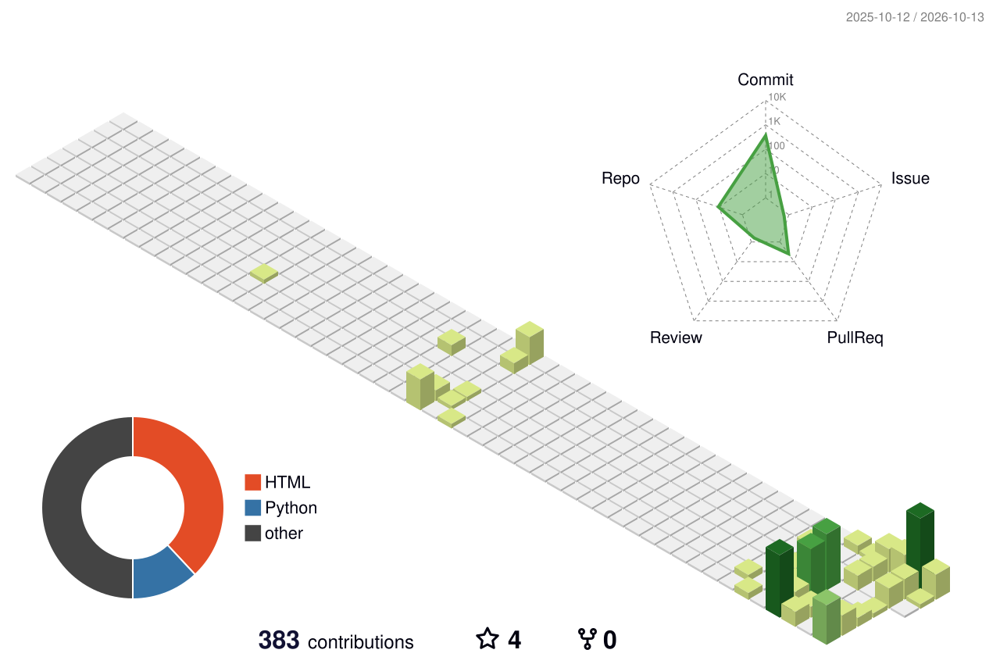

<!-- ================= 1 · HERO ================= -->

<!-- ================= 2 · ABOUT / DOSSIER ================= -->

<!-- ================= 3 · TECH STACK ORBIT ================= -->

<!-- ================= 4 · ID BADGE + DASHBOARD ================= -->

 

  
  
  
  
  

---

### 🛡️ About Me

Cybersecurity undergraduate, Web Application Penetration Tester, and systems builder working at the intersection of **Linux endpoint defense**, **offensive security auditing**, and **autonomous AI microservices**. I engineer deterministic defensive tooling, cloud compliance auditors, and real-time containment pipelines—using LLMs as high-speed accelerators for SOC triage and DevSecOps automation rather than substitutes for low-level systems understanding.

- 🎓 **Education:** BS Cyber Security, University of Central Punjab (UCP), Lahore
- 🕵️‍♂️ **Experience:** Web Application Penetration Testing (WAPT) Intern @ **IqraSec Academy** *(Cohort 02)*
- 🌐 **Community:** **Microsoft Learn Student Ambassador (MLSA)** — *Community Influencer Track*
- 🔒 **Core Focus:** Web penetration testing (OWASP Top 10), Linux endpoint containment, DevSecOps cloud auditing, and Azure/SQL security governance
- 📡 **Currently:** Scaling **CyberGPT** (NVIDIA NIM-powered SOC triage copilot) & **SecOps-AI**; preparing for the **Microsoft DP-800** certification
- 🤝 **Open to:** Security engineering roles, red/blue team research collaborations, and open-source defensive tooling

---

### ⚙️ Featured Projects

| Project | Description | Tech Stack | Status |
| :--- | :--- | :--- | :---: |
| 🧠 [**`CyberGPT`**](https://github.com/umairs759/CyberGPT) | Defensive cybersecurity AI copilot for real-time SOC alert triage, incident playbooks, and interactive threat simulation drills | `NVIDIA NIM` • `Python` • `Vercel` • `LLM Orchestration` | `Production` 🟢 |
| ☁️ [**`SecOps-AI`**](https://github.com/umairs759/SecOps-AI) | Automated DevSecOps & cloud configuration auditing framework built for the Gen AI Academy APAC Edition | `Google Cloud Run` • `Gemini API` • `Firebase` • `Firestore` | `Cloud Native` 🟢 |
| 🛡️ [**`auto-incident-responder`**](https://github.com/umairs759/auto-incident-responder) | Real-time Linux endpoint telemetry monitoring and active-defense automated process/network containment engine | `Python` • `FastAPI` • `WebSockets` • `Docker` • `Linux Signals` | `Active Defense` 🟢 |
| 🤖 [**`LocalBiz AI`**](https://github.com/umairs759/LocalBiz-AI) | Autonomous multi-model conversational WhatsApp agent and workflow orchestrator with automated failover | `FastAPI` • `Groq LLaMA 3.3` • `Gemini 2.0 Flash` • `Docker` | `Active` 🟢 |
| ⚡ [**`RetailFlow-POS`**](https://github.com/umairs759/RetailFlow-POS) | Zero-dependency, offline-first point-of-sale and inventory control engine with deterministic local transaction caching | `Vanilla JS` • `HTML5/CSS3` • `LocalStorage Engine` | `Offline-1st` 🟢 |

Explore all repositories & 3D WebGL experiments: <a href="https://github.com/umairs759?tab=repositories">github.com/umairs759?tab=repositories</a>

---

### 🏗️ Engineering Scope

| Domain | Production Scope & Execution |
| :--- | :--- |
| **Offensive & Defensive Security** | Web App Penetration Testing (SQLi, Auth Bypass, XSS), Linux kernel hardening, active endpoint containment scripts, packet auditing |
| **Applied AI & SOC Copilots** | Multi-model failover pipelines (`NVIDIA NIM`, `Groq LPU`, `Gemini`), automated SOC triage playbooks, deterministic JSON tool-calling routers |
| **Cloud & DevSecOps** | Serverless container deployments (`Google Cloud Run`, `Azure`), IAM & cloud config auditing, `Docker` microservices, `Firestore` telemetry |
| **Backend & Data Governance** | High-throughput asynchronous `FastAPI` REST/WebSocket services, webhook ingestion, `MS SQL Server` schema design & RBAC auditing |
| **Frontend & 3D WebGL** | Interactive 3D spatial layouts (`Three.js` / WebGL), offline-first UI architectures, zero-latency client state machines |

---

### 🏅 Certifications & Credentials

| Credential | Issuing Body | Domain Focus | Status |
| :--- | :---: | :--- | :---: |
| **Cloud Security & Monitoring Tasks** | Microsoft Applied Skills | Azure security baselines, alert monitoring, IAM governance | `Verified` 🟢 |
| **Foundations of Cybersecurity** | Google (Coursera) | Security frameworks (NIST, CIA triad), SIEM, threat intel, asset defense | `Verified` 🟢 |
| **Cybersecurity Job Simulation** | Deloitte (Forage) | Corporate network defense, packet inspection, log investigation & triage | `Completed` 🟢 |
| **DP-800: SQL Data & Governance** | Microsoft Certified | Relational database administration, T-SQL querying, RBAC & data security | `Oct 2026 Exam` 🎯 |

---

### 🏆 Honors, Programs & Milestones

- ☁️ **Gen AI Academy APAC Edition:** Engineered & submitted **SecOps-AI** (Automated Cloud & DevSecOps Security Auditor)
- 🎖️ **Grade 2A Placement:** Alibaba Cloud AI Hackathon Pakistan
- 🌐 **Top 20% Global Rank:** International Research Olympiad (IRO)
- 🛡️ **85/100 Aptitude Score:** Bano Qabil 2.0 Advanced Cyber Security Track
- 🧪 **Continuous Offensive Labs:** Active practitioner on **TryHackMe** & **PortSwigger Web Security Academy**

---

### 🌃 Contribution City
<!-- Generated daily by .github/workflows/profile-3d.yml -->
<picture>
  <source media="(prefers-color-scheme: dark)" srcset="profile-3d-contrib/profile-night-view.svg">
  
</picture>

 

### 📊 GitHub Stats

<table align="center" border="0" cellpadding="0" cellspacing="0">
  <tr>
    <td>
      
    </td>
    <td>
      
    </td>
  </tr>
  <tr>
    <td colspan="2" align="center">
      
    </td>
  </tr>
</table>

 

<!-- ================= 5 · CONNECT & COLLABORATION HUB ================= -->

  

### ⚡ Initiate Secure Handshake // Let's Connect & Collaborate

> **Looking to collaborate on defensive security tooling, red/blue team research, autonomous AI workflows, or open-source initiatives?** Feel free to drop a signal across any channel below.

 

<!-- Collaboration Telemetry Matrix -->
| 🎯 Collaboration Domains | 📡 Telemetry & SLA | 🤝 Direct Signal Uplink |
| :--- | :---: | :--- |
| • Web Penetration Testing & Defense • Active Linux Endpoint Containment • Autonomous Agentic AI & SOC Copilots |    | • [📩 Direct Dispatch (Email)](mailto:umairghaffar759@gmail.com) • [💼 Professional Network (LinkedIn)](https://linkedin.com/in/umairs759) • [🌐 Production Hub (Portfolio)](https://umairs759.github.io/Muhammad-Umair-Portfolio/) |

 

<!-- Sleek Tactical Action Badges -->

  
  &nbsp;
  
  &nbsp;
  

 

 
🛡️ System Telemetry: Encrypted & Operational

